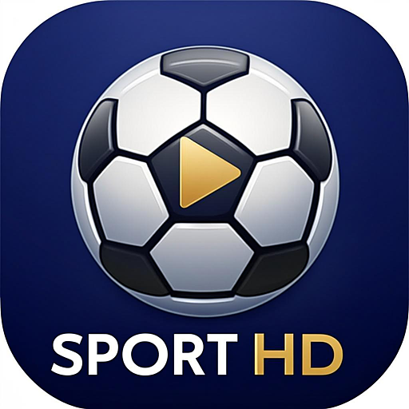

**Bienvenue dans le dépôt de chakir1981**

Add-on **SportHD** et dépôt pour Kodi — léger et sans superflu.

N'hésitez pas à ouvrir une issue si quelque chose ne fonctionne pas !

[Suivez-moi sur GitHub](https://github.com/chakir1981)

## Installer dans Kodi

1. Téléchargez le zip du dépôt : [repository.chakir1981-2.9.2.zip](https://raw.githubusercontent.com/chakir1981/tonton.github.io/master/repository.chakir1981-2.9.2.zip)
2. Dans Kodi : **Paramètres → Add-ons → Installer depuis un fichier zip** → choisissez le zip téléchargé.
3. Puis : **Installer depuis un dépôt → Dépôt chakir1981 → Add-ons vidéo → SportHD**.

Kodi propose automatiquement les mises à jour de SportHD ensuite.

## L'add-on SportHD

[**Code source de SportHD**](https://github.com/chakir1981/tonton.github.io/tree/master/plugin.video.sporthdme)

Agenda sportif en direct : **ÉVÉNEMENTS EN DIRECT** — tous les matchs du jour, avec pour les rencontres dépourvues de source française des liens de secours vers les chaînes sport françaises 24/7 (beIN Sports 1-3 + MAX 4-10, RMC Sport 1-2, Canal+…). Le programme TV de **footao.tv** (football) et le programme TV sport de **Téléobs** (tous sports : NFL, NBA, hockey, rugby, tennis…) permettent de proposer **la chaîne qui diffuse vraiment le match** (réglages on/off), et les matchs avec sources françaises sont affichés en tête de liste. Un réglage « Uniquement les sources françaises » est disponible dans les paramètres de l'add-on.
